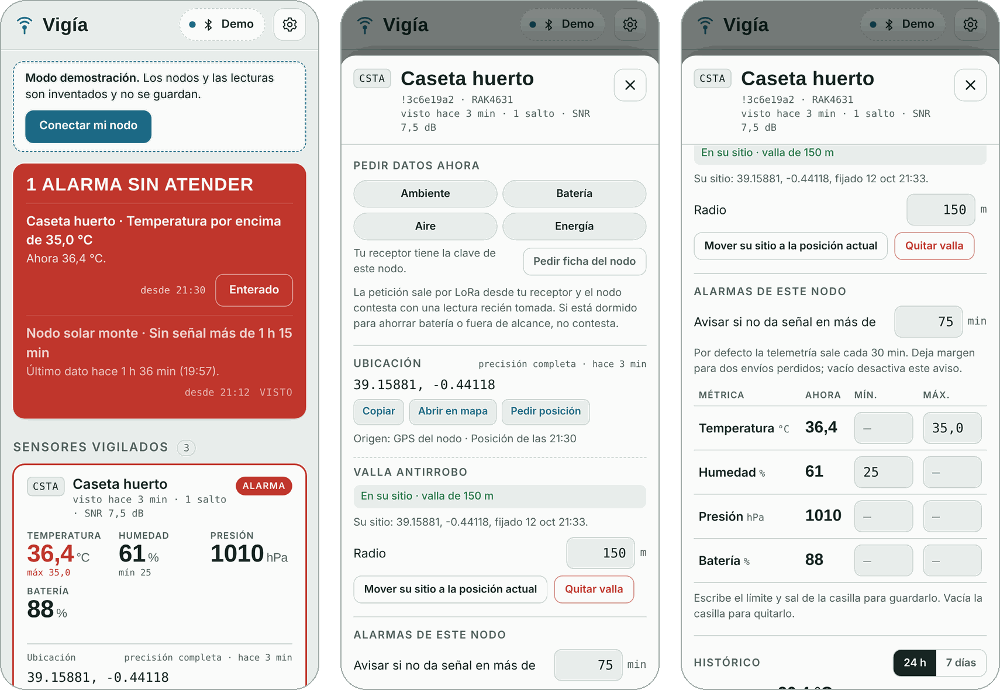

# Vigía Mesh

Panel de telemetría y alarmas para nodos [Meshtastic](https://meshtastic.org) que funciona **sin internet**. El móvil se conecta por Bluetooth a un nodo receptor, y los sensores le llegan por LoRa.

**Abrir la app:** https://dani-nros.github.io/vigia-mesh/

> **Versión beta.** La app funciona, pero aún se está probando con distintos nodos y móviles. Si algo falla o echas algo en falta, [abre un aviso](https://github.com/Dani-NRos/vigia-mesh/issues).

<p align="center"></p>

## Qué hace

- **Panel de sensores.** Muestra las últimas lecturas de cada nodo vigilado y una mini gráfica de 24 h.
- **Alarmas en la propia app, con sonido, vibración y notificación:**
  - un valor sale del mínimo o máximo que fijas por métrica;
  - un nodo lleva más de X minutos sin dar señal;
  - el receptor se desconecta (la app reintenta la conexión sola).
- **Pedir datos ahora.** Pide a un nodo una lectura en el momento: ambiente, batería, calidad del aire o energía (INA). Si el nodo no tiene ese sensor o no le llega la petición, la app lo dice.
- **Pedir ficha del nodo.** Desde el firmware 2.5, el receptor solo manda peticiones a nodos de los que tiene la clave pública (si no, da el error 39). Este botón pide al nodo su ficha (nombre y clave) y de paso le envía la del receptor. Un nodo no repite su ficha si ya te la mandó en las últimas horas.
- **Ubicación y valla antirrobo.** Muestra las coordenadas de cada nodo (se copian con un toque y se abren en Google Maps), su precisión y si vienen del GPS o están fijadas a mano. Puedes pedirle la posición al momento. Para un nodo vigilado, fijas su sitio y un radio: si dos posiciones seguidas caen fuera, salta la alarma «Fuera de su sitio». Ojo: en el canal público la posición viaja recortada a unos 730 m, y un nodo con la posición fijada a mano no delata un robo (para eso está la alarma de «sin señal»).
- **Avisos por la malla.** Cada alarma (umbral, sin señal, fuera de su sitio) puede salir como mensaje Meshtastic a un canal privado, a un nodo o a ambos, y si quieres también cuando se resuelve. En directo a un nodo, confirma la entrega. Los canales públicos (sin cifrar, con la clave por defecto o la de eventos) están bloqueados. Como mucho un mensaje cada 8 s y 20 por hora.
- **Histórico en el propio móvil.** Gráficas de 24 h y 7 días, y exportación a CSV.
- **Modo demostración** con nodos inventados, para probarla sin hardware.

Todos los datos se quedan en el dispositivo. La app no envía nada a ningún servidor.

## Requisitos

- **Navegador.** Chrome en Android, o Chrome/Edge en el ordenador. En iPhone no funciona porque Safari no tiene Bluetooth web.
- **Receptor.** Un nodo Meshtastic con Bluetooth activado y en el mismo canal que los sensores.
- **Un solo cliente.** Ningún otro móvil puede estar conectado al receptor a la vez: el nodo acepta un único cliente Bluetooth.

## Instalación

1. Abre la dirección de la app en Chrome.
2. Pulsa el menú ⋮ y luego **Instalar aplicación**.
3. Desde entonces abre sin internet. Para actualizarla, ábrela una vez con conexión.

## Uso

1. **Conecta el receptor.** Pulsa **Conectar receptor** y elige tu nodo. Si no aparece, ve a Ajustes → *Mi nodo no aparece*.
2. **Elige qué vigilar.** En *Resto de la malla*, pulsa **Vigilar** en un nodo para fijarlo arriba.
3. **Pon los límites.** Toca la tarjeta para fijar mínimo y máximo por métrica y los minutos sin señal que disparan la alarma.
4. **Para usarlo como panel fijo,** activa Ajustes → *Mantener la pantalla encendida* y deja el móvil enchufado.

## Si no conecta

La app reconoce el tipo de fallo y te dice qué hacer. Lo más habitual:

- **La app de Meshtastic tiene el nodo ocupado.** En Android sigue conectada en segundo plano aunque no la abras, y el nodo solo admite un cliente Bluetooth. Ciérrala del todo o desconecta el nodo desde ella.
- **Emparejamiento roto.** Si conecta y se corta enseguida, olvida el nodo en los ajustes de Bluetooth del móvil y vuelve a conectar; Android pedirá el PIN que sale en la pantalla del nodo (sin pantalla suele ser 123456). Pasa al actualizar el firmware o al emparejar el nodo con varios aparatos. Para un receptor fijo en casa, el modo «Sin PIN» lo evita del todo, a cambio de que cualquiera a pocos metros pueda conectarse a él.
- **Otra ventana de Vigía.** Solo una ventana puede tener el receptor; la otra ofrece «Conectar aquí».

En Ajustes → *Diagnóstico de conexión* queda apuntado cada paso. Si falla, cópialo: dice en qué paso se corta.

## Avisar de un fallo

Los fallos y las sugerencias se recogen en los [avisos de GitHub](https://github.com/Dani-NRos/vigia-mesh/issues). Si es un problema de conexión, el botón **Avisar del fallo en GitHub** (en Ajustes → *Diagnóstico de conexión*) abre un aviso nuevo con el diagnóstico ya pegado. Añade el modelo del nodo receptor y su versión de firmware. Los avisos son públicos: revisa el texto antes de enviarlo.

## Límites conocidos

- **Solo en primer plano.** Las alarmas saltan con la app abierta y en pantalla; con el móvil bloqueado, Chrome congela la página. Al volver, la app recoge lo que guardó el receptor y marca como «recibida al reconectar» lo que pasó mientras tanto.
- **No es tiempo real.** La telemetría sale cada 30 min por defecto, así que una alarma de umbral puede llegar con ese retraso. En 868 MHz el tiempo de emisión está limitado: no conviene bajar mucho el intervalo.
- **Nodos dormidos.** Un nodo en modo de ahorro de energía no escucha mientras duerme, así que no contesta a *Pedir datos ahora*.

## Código fuente

El código está en la carpeta [`codigo/`](codigo/). Para compilar:

```
cd codigo
npm install
npm run build
```

El resultado queda en `dist/app/`.

## Licencia

GPL-3.0. Vigía Mesh usa la librería oficial [`@meshtastic/core`](https://www.npmjs.com/package/@meshtastic/core), publicada con licencia GPL-3.0, así que todo el proyecto se distribuye con la misma licencia. La conexión Bluetooth es propia (`codigo/src/ble.js`): serializa las operaciones porque Android solo admite una a la vez. El texto completo está en [LICENSE](LICENSE).

Meshtastic® es una marca registrada de Meshtastic LLC. Este proyecto es independiente y no está afiliado a Meshtastic.
